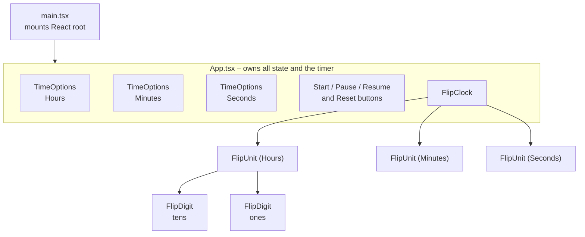
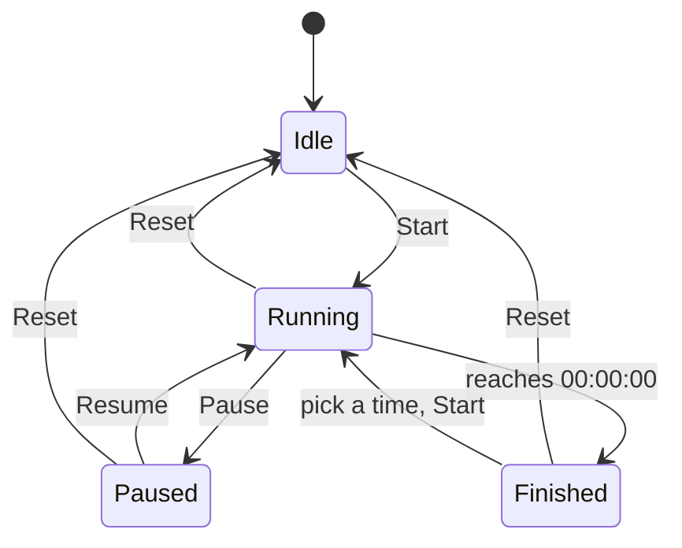
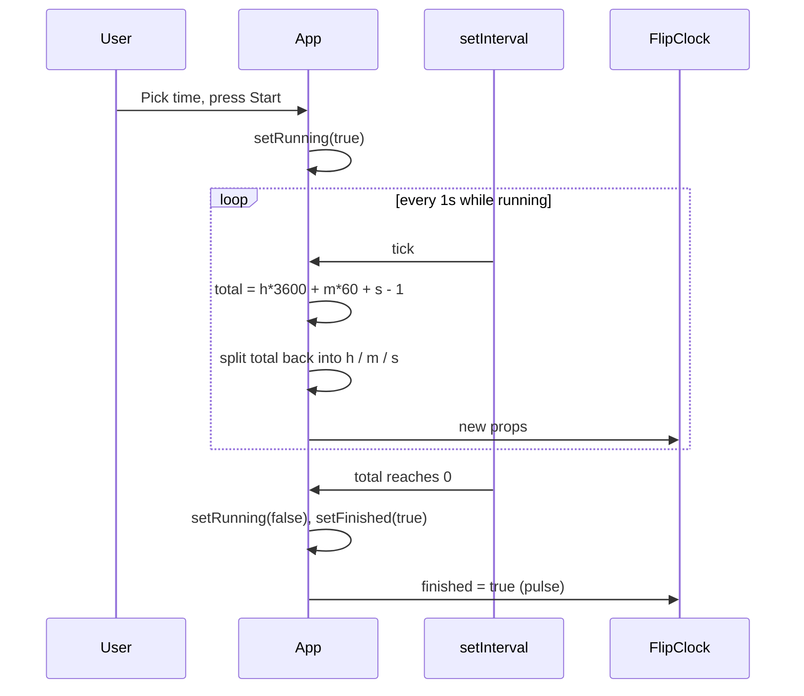

# Countdown Timer – Retro Flip Clock

A countdown timer with a retro flip-clock display. Pick hours, minutes and seconds, press **Start**, and watch each digit flip down to zero.

Built with React 19, TypeScript and Vite. No runtime dependencies beyond React.

## Features

- Countdown from up to 23:59:59 with **Start / Pause / Resume** and **Reset**
- Time inputs are locked while the clock is running
- Two-flap flip animation on every digit change (pure CSS 3D transforms)
- Clock dims while paused and pulses when the countdown finishes
- Light and dark themes (follows the OS setting)
- Responsive layout, from phones to large screens
- Accessible: the clock exposes one readable label (`role="timer"`), and flip animations are turned off under `prefers-reduced-motion`

## Getting started

```bash
npm install
npm run dev       # start the dev server
npm run build     # type-check and build to dist/
npm run preview   # serve the production build locally
npm run lint      # run ESLint
```

## Architecture

### Component tree



`FlipUnit` splits a number into a tens and a ones digit. Minutes and Seconds work the same way, so every `FlipDigit` is an independent card.

### Timer states



| State | `running` | `started` | Button label |
|---|---|---|---|
| Idle | false | false | Start |
| Running | true | true | Pause |
| Paused | false | true | Resume |

The Start button is disabled while the time is 00:00:00. The time inputs are locked only while `running`, so they can be edited while paused.

### Countdown tick



## Project structure

```
src/
├── main.tsx         # entry point, mounts <App />
├── App.tsx          # state, countdown effect, controls layout
├── TimeOptions.tsx  # reusable 00–N <select> for one time unit
├── FlipClock.tsx    # FlipClock → FlipUnit → FlipDigit
├── App.css          # layout, controls, flip card styles and animation
└── index.css        # theme variables (light/dark), base styles
public/
└── favicon.svg
```
